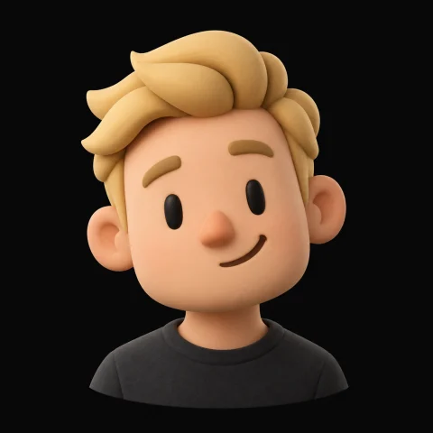
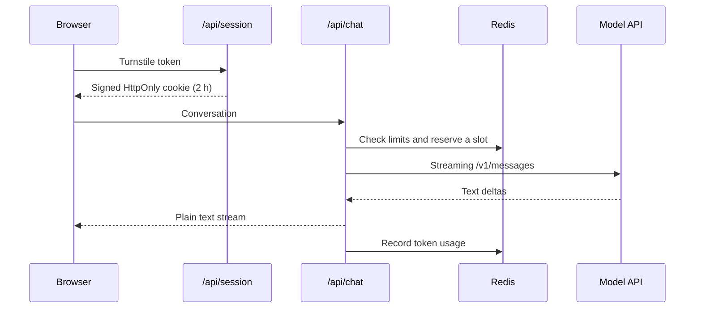

<div align="center">



# agentpresentator

A personal site where visitors talk to an AI version of you, voiced by an animated clay avatar.

[](https://nextjs.org)
[](https://react.dev)
[](https://www.typescriptlang.org)
[](Dockerfile)

</div>

## Overview

agentpresentator is a one-page Next.js app. The avatar greets visitors, suggests questions, and streams answers at a speaking pace while its talking loop plays. The agent answers only from a Markdown profile you write, and it can attach project cards and follow-up suggestions to a reply.

The backend is designed to run on a public site with a paid model behind it. Every chat is tied to a signed session and passes rate limits and a daily token budget, and it can require a Cloudflare Turnstile check.

## Getting started

Requires Node.js 24.

```bash
npm install
npm run dev
```

Open [localhost:3000](http://localhost:3000). When `MODEL_API_KEY` is empty, the chat streams canned replies, so you can work on the UI offline. To connect a model, copy `.env.example` to `.env` and set `MODEL_BASE_URL` and `MODEL_API_KEY`.

| Script | Purpose |
| --- | --- |
| `npm run dev` | Development server |
| `npm run build` | Production build (standalone output) |
| `npm run start` | Serve the production build |
| `npm run typecheck` | TypeScript check |
| `npm run avatar -- <folder>` | Build avatar assets from your source files |

## Make it yours

### Persona

| Path | Contents |
| --- | --- |
| [`content/profile.md`](content/profile.md) | Everything the agent knows about you. The agent may repeat any of it, so keep it free of private details. |
| [`content/site.ts`](content/site.ts) | Name, contact links, suggested questions, `/` topics and project cards |
| [`public/logos/`](public/logos) | Logos shown on project cards |

In a reply, the model writes `[[project:id]]` to show a project card and `>> a | b | c` to offer follow-up questions. The client renders both as plain text components and never injects HTML.

### Avatar

Generate a portrait of yourself with any AI image tool. Optionally, animate it into idle and talking loops with an image-to-video model. Then build the web assets:

```bash
npm run avatar -- ./my-avatar   # portrait.png, plus optional portrait-open.png, idle.mp4 and talking.mp4
```

The script crops and compresses everything into `public/avatar/` and regenerates the favicons. For a still avatar, a single portrait is enough. **[Read the avatar guide](docs/AVATAR.md)** for ready-to-use prompts, tips for seamless loops and troubleshooting.

## Architecture



The model client uses the Anthropic Messages API format, so `MODEL_BASE_URL` can point to Anthropic or to any compatible gateway. The system prompt is cached between requests.

## Security

- **Sessions**: HMAC-signed cookies that are `HttpOnly` and scoped to `/api`, with optional Cloudflare Turnstile
- **Requests**: origin check, 64 KB body limit, and schema validation with alternating turns, 800-character questions and at most 24 messages
- **Limits**: per session, per IP (hourly and daily), concurrent replies per IP, and global daily caps on messages and tokens
- **Browser**: nonce-based Content Security Policy that blocks framing
- **Runtime**: non-root user, read-only filesystem, all capabilities dropped, and `no-new-privileges`
- **Fail-closed**: in production, the chat returns 503 if any required variable is missing

## Configuration

| Variable | Required | Default | Description |
| --- | :---: | --- | --- |
| `SITE_ORIGIN` | ✓ | | Public origin. It must exactly match the browser's address bar. |
| `MODEL_BASE_URL` | ✓ | | Base URL of an Anthropic-compatible API, without `/v1` |
| `MODEL_API_KEY` | ✓ | | API key for the model |
| `SESSION_SECRET` | ✓ | | At least 32 random characters, for example from `openssl rand -hex 32` |
| `REDIS_URL` | ✓ | | Redis URL for rate-limit counters. Compose sets it for you. |
| `MODEL_ID` | | `claude-sonnet-4-6` | Model name |
| `MAX_OUTPUT_TOKENS` | | `700` | Maximum tokens per reply |
| `TURNSTILE_SITE_KEY`, `TURNSTILE_SECRET_KEY` | | | Enable the Turnstile check |
| `TRUSTED_PROXY_HOPS` | | `1` | Number of reverse proxies in front of the app |
| `LIMIT_*` | | see [`.env.example`](.env.example) | Rate limits and daily budgets |

## Deployment

The included [`compose.yaml`](compose.yaml) runs the app with a private Redis instance that keeps its data in memory only.

```bash
docker compose up -d --build
```

Put the `web` service on port `3000` behind a reverse proxy that terminates HTTPS. It works as is with Dokploy and Traefik. The container reports its health at `GET /api/health`.

## Project structure

```
app/          Page, layout and API routes (chat, session, health)
components/   Chat experience, avatar and reply rendering
content/      Persona and public site content
docs/         Guides, including creating your avatar
lib/          Model client, limits, sessions, validation, config
public/       Avatar media and logos
scripts/      Avatar build script
proxy.ts      Content Security Policy
```
